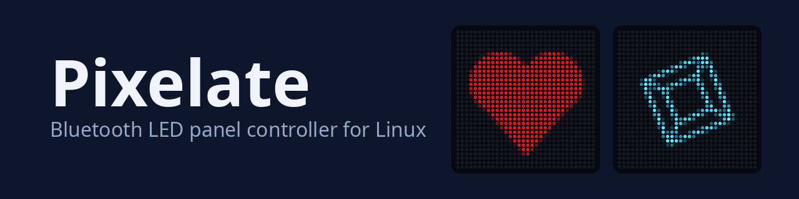
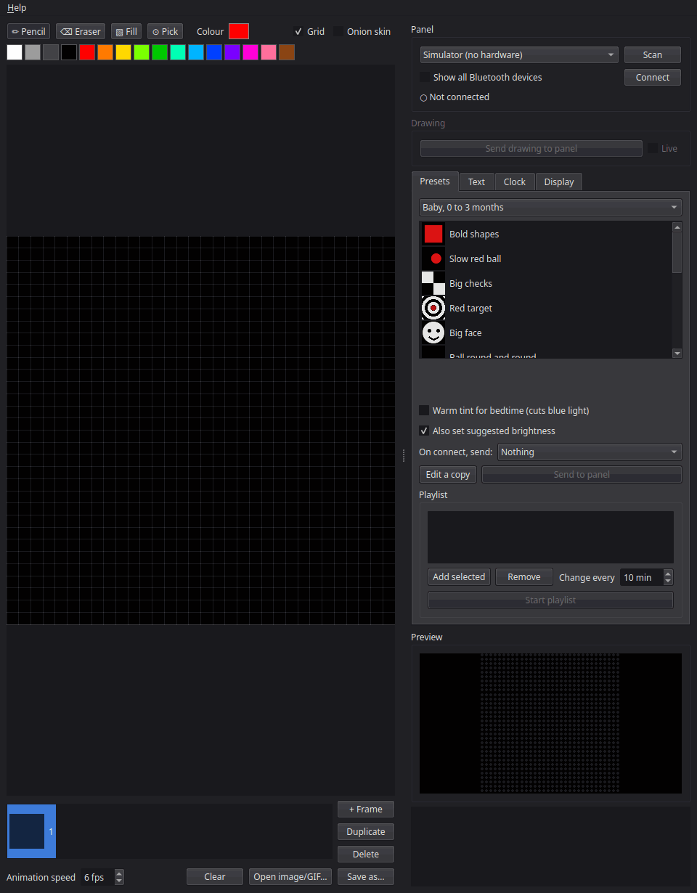
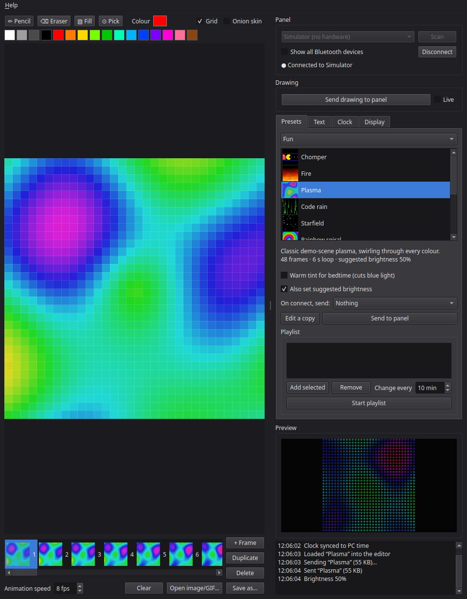
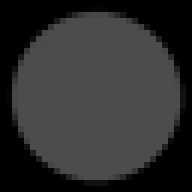
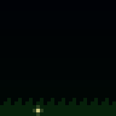

<p align="center">
  
</p>

<p align="center">
  <a href="#features">Features</a> · <a href="#quick-start">Quick start</a> · <a href="docs/GUIDE.md">Guide</a> · <a href="docs/recovery.md">Recovery</a> · <a href="CHANGELOG.md">Changelog</a>
</p>

<p align="center">
  
  
  
  
  
</p>

Draw, animate and send pixel art to a 32×32 Bluetooth LED panel from a Linux desktop, instead of the phone app.

Tested on an iDotMatrix panel. iPixel Color panels are supported through their library but have not been tried.

<p align="center">
  
</p>

## Quick start

Needs Linux, Python 3.12 or newer and a bold TrueType font such as DejaVu Sans Bold (`fonts-dejavu-core` on Debian and Ubuntu).

```bash
git clone https://github.com/c0def0rc0ffee/Pixelate.git
cd Pixelate
python3 -m venv .venv
.venv/bin/pip install -r requirements.txt
.venv/bin/python -m pixelate
```

Pick **Simulator (no hardware)** in the device list and click **Connect**. The preview shows exactly what a panel would.

For a real panel you also need BlueZ. Close the phone app (the panel takes one connection at a time), run `bluetoothctl power on`, then click **Scan** and **Connect**. The [guide](docs/GUIDE.md#connecting) covers the rest, and [recovery](docs/recovery.md) gets a stuck panel back. `tools/install-desktop.sh` adds Pixelate to the application menu.

## Features

| Feature | What it does |
|---|---|
| **Editor** | Pencil, eraser, fill and colour picker, frames with onion skin, undo and redo. Opens any image or GIF; saves PNG or animated GIF. |
| **Presets** | Four collections: "Baby, 0 to 3 months", Soothing, Fun and Development. Preview, send or edit a copy. |
| **Playlist** | Rotates chosen presets every few minutes and reconnects if the panel drops the link. |
| **Text and clock** | The panel's scrolling text and digital clock, plus an analogue clock face redrawn every minute. |
| **Safety** | Every preset passes a flash check, and the log warns when a drawing of your own flashes quickly. |
| **Simulator** | Every tab works with no hardware. |
| **System tray** | Closing the window keeps the playlist and the connection running. |

<p align="center">
  
</p>

## Preset gallery

Real preset animations, including one from the "Baby, 0 to 3 months" collection.

| Bold shapes (Baby, 0 to 3 months) | Fireworks then fireflies (Soothing) | Spinning cube (Fun) |
|---|---|---|
|  |  |  |

## Safety

The test suite holds every preset to a flash limit: no more than a tenth of the panel may change brightness faster than twice a second, which is stricter than the WCAG three flashes rule. Sleepy presets, marked with a moon, are dim and red or amber with almost no blue.

## Documentation

- [User guide](docs/GUIDE.md): every tab, every preset collection and the flash check.
- [Recovery](docs/recovery.md): getting the panel back to a known state.
- [Hardware findings](HANDOVER.md): what the real panel taught us.
- [Changelog](CHANGELOG.md)

## Development

```bash
.venv/bin/pip install pytest
.venv/bin/python -m pytest tests
```

No test needs a panel or Bluetooth. Release builds are described in [Building releases](docs/GUIDE.md#building-releases).

## Licence

MIT. See [LICENSE](LICENSE).
